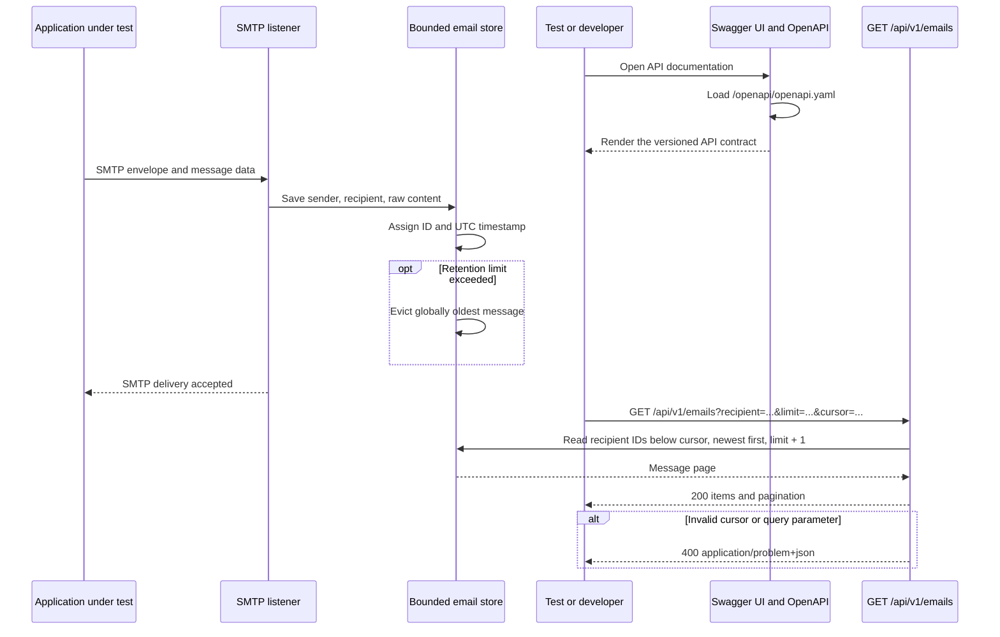

# Email capture

Read when changing the user-visible SMTP capture and HTTP retrieval capability, its flow, contract,
retention, or dependencies.

## Purpose and behavior

Email capture lets an application under test send SMTP messages without contacting a real mail
provider. The service accepts unauthenticated SMTP envelopes, stores messages in bounded process
memory, and provides a read-only, versioned HTTP collection endpoint for exact recipient lookup.

Messages contain the SMTP envelope sender and recipient, receipt timestamp, process-local ID, and
raw UTF-8 content. They survive concurrent access but not process restarts. The globally oldest
message is evicted when the configured retention limit is exceeded.

## Inputs and outputs

- SMTP input on the configured host and port; authentication and TLS are disabled.
- Runtime controls from `smtp.server.*` and `email.storage.max-total-messages`.
- HTTP output from `GET /api/v1/emails` using required `recipient`, bounded `limit`, and optional
  opaque `cursor` query parameters.
- MCP access through [`resources/docs/mcp-access/feature.md`](../mcp-access/feature.md), which reuses
  the same query semantics and sends through the real SMTP listener.
- OpenAPI 3.1 contract at [`resources/oas/openapi.yaml`](../../oas/openapi.yaml), packaged and served
  at `/openapi/openapi.yaml` for Swagger UI and other API tooling.

The HTTP response owns its transport shape and does not serialize the internal storage record. It
returns newest messages first using the standard `items` and `pagination` envelope.

## Feature flow

## Implementation and dependencies

- `integration.smtp.SmtpServerLifecycle` owns the SubEtha SMTP server lifecycle.
- `integration.smtp.SmtpMessageListener` adapts SMTP deliveries to `email.EmailStore`.
- `email.EmailStore` owns synchronized indexes, IDs, timestamps, and eviction.
- `email.EmailCursorCodec` owns versioned opaque cursor encoding.
- `email.EmailQueryService` owns shared REST and MCP query validation and pagination orchestration.
- `controller.email.EmailService` maps internal messages to API-owned response records.
- `controller.email.EmailController` exposes the `/api/v1` boundary.
- `core.http.OpenApiResourceConfiguration` serves the packaged contract used by Swagger UI.
- `controller.GlobalExceptionHandler` renders stable problem responses.

The feature depends on Spring Boot Web, Validation, Actuator, Springdoc, and SubEtha SMTP. It has no
database or external service dependency.

## Limitations

The service is intended for trusted development and test networks. It does not authenticate SMTP or
HTTP clients, negotiate SMTP TLS, persist messages, normalize recipient addresses, expose message
deletion, or guarantee that retained older pages remain available while eviction continues.
