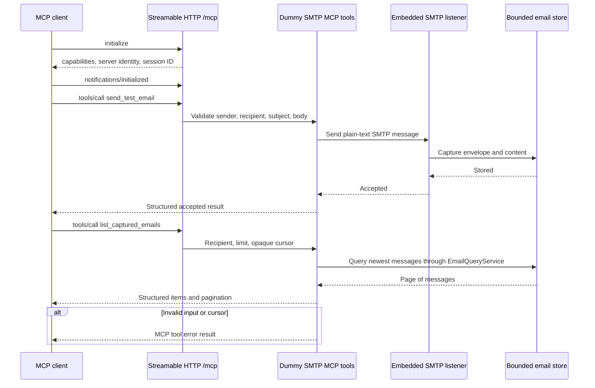

# MCP access

Read when changing how MCP clients send test messages, inspect captured messages, check service
health, or connect to the embedded Streamable HTTP server.

## Purpose and behavior

MCP access lets an AI client use the dummy SMTP service without translating MCP calls into REST or
SMTP itself. The MCP server is embedded in the same Spring Boot process and becomes available at
`/mcp` when the application starts.

It exposes three tools:

- `send_test_email` sends a plain-text message through the real embedded SMTP listener.
- `list_captured_emails` retrieves exact-recipient messages using the same domain query and cursor
  ordering as the REST API.
- `get_service_health` reports whether the service and SMTP listener are running.

## Feature flow

## Inputs and outputs

The MCP endpoint uses Streamable HTTP and session negotiation. `list_captured_emails` accepts a
required `recipient`, optional `limit` from 1 to 100, and optional opaque `cursor`. The returned
pagination cursor is an empty string when `hasNext` is false.

`send_test_email` requires sender, recipient, subject, and plain-text body. It returns acceptance
metadata; clients call `list_captured_emails` to inspect the resulting captured content.

## Dependencies and limits

The feature uses Spring AI's WebMVC MCP server starter and the same `EmailQueryService`, SMTP
lifecycle, and bounded store as the REST feature. It has no separate process, port, or database.

The endpoint has no authentication and is suitable only for trusted development and test networks.
Disable it with `DUMMY_SMTP_MCP_ENABLED=false` when it is not needed. Add an explicit security layer
before any untrusted or remote exposure.
